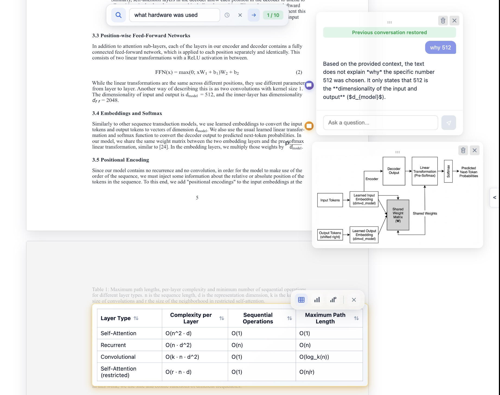

# PDF Layout Parser

Lightweight TypeScript library for extracting text runs and basic layout metadata from PDF files without third-party parsing dependencies. The focus is on a modular architecture that can evolve toward full PDF specification coverage.

## Immersive PDF viewer

I have a long list of papers I want to read, including some outside my field. Often I can follow the paper until one equation, paragraph, or table slows me down. I want to understand that part and then pick up the author's argument where I left off. This browser viewer is an experiment in putting that help right next to the original page.



- **Discuss a passage.** Ask a question about a specific section, follow up in the same thread, and return to the saved conversation later. In the screenshot, I asked why the paper uses 512 dimensions.
- **Explore a figure or table.** Ask for a visual explanation of a difficult passage, sort a table by a column, or switch to a chart to see how the values compare.
- **Find the source of an answer.** Ask a question about the whole document. The viewer uses retrieval-augmented generation (RAG) to find relevant passages and answer with citations. Select a citation to jump to the passage and see it highlighted.

I'd like to extend this to more parts of a paper and to other document formats, so readers can explore unfamiliar material while keeping the author's original work in view.

## Getting Started

```bash
npm install
npm run build
```

## Usage

```ts
import { readFileSync } from 'node:fs';
import { PDFDocument, CanvasRenderer } from 'pdf-layout-parser';

const bytes = readFileSync('invoice.pdf');
const document = PDFDocument.from(bytes);

for (const page of document.pages) {
  for (const item of page.textItems) {
    console.log(page.number, item.bounds.minX, item.bounds.minY, item.text);
  }
}

// Debug viewer (browser)
const canvas = document.getElementById('preview') as HTMLCanvasElement;
const renderer = new CanvasRenderer({ scale: 1.25 });
renderer.render(canvas, document, 1);
```

### Gemini API Helper

```ts
import { GeminiAPI } from 'pdf-layout-parser';

const gemini = new GeminiAPI({ apiKey: process.env.GEMINI_API_KEY ?? '', model: 'gemini-3-pro-image-preview' });
const result = await gemini.generateText('Explain how AI works in a few words');

console.log(result.text);

const imageResult = await gemini.generateImage(
  'Create a picture of a nano banana dish in a fancy restaurant with a Gemini theme'
);

// imageResult.images[0].data contains the base64 payload for the rendered image
```

### Structured Extract (Gemini or OpenAI Provider)

```ts
import { StructuredExtractAPI } from 'pdf-layout-parser';
import { renderStructuredData } from './testApp/src/viewer/htmlStructuredDataRenderer';

const extractor = new StructuredExtractAPI({
  provider: 'gemini', // or 'openai'
  apiKey: process.env.GEMINI_API_KEY ?? '',
  model: 'gemini-3-pro-preview'
});

const pdfFile = new File([bytes], 'document.pdf');
const { document, assetMap } = await extractor.extractStructuredData(pdfFile);

renderStructuredData(container, document, { assetMap });
```

## Development

- `npm run build` – install deps and build both the library and `testApp`.
- `npm run build:lib` – compile TypeScript library to `dist/`.
- `npm run build:server` – compile the optional Node LLM proxy to `dist-server/`.
- `npm run start:server` – build and run the proxy server on `http://localhost:8787`.
- `npm test` – execute the Vitest suite.
- `npm run lint` – run type-checking.

## Docker

The repo now includes a single-container deployment path for the built backend and frontend.

The container runs the same production-origin path as `npm run cloudflare:origin:start`:

- one local origin for the built React app and all proxy APIs
- `/` redirects to `/proxy`
- runtime task/cache/log data is stored in the named Docker volume `llm_proxy_data`
- `poppler-utils` is installed in the image, so `pdfseparate` and `pdfunite` remain available for progressive page splitting/batching

### Build and Run Locally

```bash
cp .env.example .env
# set PUBLIC_ORIGIN, provider keys, and proxy auth in .env
docker compose build
docker compose up -d
```

The default `.env.example` keeps the origin bound to `127.0.0.1:8787`, which is the right fit for Cloudflare Tunnel. Point `cloudflared` at `http://127.0.0.1:${HOST_PORT}` on the host machine.

Useful commands:

```bash
docker compose logs -f
docker compose down
docker compose ps
```

If you want a different bind address or host port, set `HOST_BIND` and `HOST_PORT` in `.env`.

If you are not running behind HTTPS, set `LLM_PROXY_SESSION_COOKIE_SECURE=false`.

### Private Transfer Without Any Registry

If you want the image to stay private to you and avoid publishing anywhere, transfer it directly as a tarball:

```bash
docker compose build
docker save simple-pdf-parser:latest | gzip > simple-pdf-parser-image.tar.gz
```

If you changed `IMAGE_NAME` in `.env`, save that tag instead of `simple-pdf-parser:latest`.

Copy `simple-pdf-parser-image.tar.gz` and your `.env` file to the other machine using `scp`, `rsync`, an encrypted drive, Tailscale, or any other private channel you control. Treat `.env` as sensitive because it can contain provider API keys and auth settings.

On the other machine:

```bash
docker load < simple-pdf-parser-image.tar.gz
cp .env.example .env
# or copy the already-configured .env from the source machine
docker compose up -d --no-build
```

This is the most private option because the image never leaves your control and never lands in a hosted registry.

### Private Registry Option

If you want convenient pull-from-anywhere behavior, use a private registry you control. A practical choice is GitHub Container Registry (`ghcr.io`) with a private package under your personal account.

Set `IMAGE_NAME` in `.env` to the private image name you want to publish, for example:

```bash
IMAGE_NAME=ghcr.io/<your-github-username>/simple-pdf-parser:latest
```

Build and push:

```bash
docker login ghcr.io
docker compose build
docker compose push
```

On another machine:

```bash
docker login ghcr.io
docker pull ghcr.io/<your-github-username>/simple-pdf-parser:latest
cp .env.example .env
# keep IMAGE_NAME pointing at the same private registry tag
docker compose up -d --no-build
```

For GitHub Container Registry:

- first publish is private by default
- pulling a private image requires authentication
- for CLI use across machines, use a GitHub personal access token with the package scopes you need

If you prefer Docker Hub private repos or a self-hosted registry, the same pattern applies: set `IMAGE_NAME` to that registry path, build, push, then pull on the other machine.

If you rely on Codex execution routes, note that the image does not install the `codex` CLI itself. Keep `CODEX_EXEC_ENABLED=false` unless you derive a custom image that adds that binary.

### Optional LLM Proxy Backend

This repo now includes a separate TypeScript backend under [server/src/index.ts](/Users/rdolgov/code/simple-pdf-parser/server/src/index.ts). It is meant to sit between the browser UI and upstream LLM providers so the app can either:

- use task-oriented backend routes for all UI AI features, and
- optionally expose provider-specific passthrough proxy routes for debugging or external tooling.

The web app now talks to functionality-based task routes instead of provider/model-specific URLs. The main task routes are:

- `POST /api/tasks/documents` to upload a PDF, persist it server-side, and start backend detection
- `GET /api/tasks/documents/<documentId>` to poll for detection status/result
- `POST /api/tasks/ask-question`
- `POST /api/tasks/generate-widget`
- `POST /api/tasks/analyze-formula`
- `POST /api/tasks/logical-structure`
- `POST /api/tasks/analyze-relevance`
- `POST /api/tasks/analyze-image`
- `POST /api/tasks/generate-image`
- `POST /api/tasks/generate-table-infographic`
- `POST /api/tasks/build-semantic-index`
- `POST /api/tasks/search-semantic`

Route aliases also exist under `/proxy/api/tasks/...`, so the app can be opened at `/proxy` while still keeping the same backend task API contract.

The backend keeps per-user/per-file state under `LLM_PROXY_TASKS_DIR`, including:

- uploaded PDF bytes
- structured detection results
- semantic index caches
- interaction logs for user/document/task activity

Provider-specific passthrough proxy routes are still available on the server when you need raw upstream access:

- `POST /api/llm/openai/responses`
- `POST /api/llm/openai/embeddings`
- `POST /api/llm/openai/images/generations`
- `POST /api/llm/gemini/v1beta/models/<model>:generateContent`
- `POST /api/llm/gemini/v1beta/models/<model>:batchEmbedContents`
- `POST /api/llm/gemini/v1beta/models/<model>:embedContent`
- `GET /api/auth/session`
- `POST /api/auth/login`
- `POST /api/auth/logout`

Server environment variables:

- `PORT` defaults to `8787`
- `LLM_PROXY_AUTH_TOKEN` is optional shared auth checked against `Authorization: Bearer ...` or Gemini `?key=...`
- `LLM_PROXY_USERS` is optional predefined cookie-login users in `username:password,username:password` format
- `LLM_PROXY_SESSION_COOKIE_NAME` defaults to `llm_proxy_session`
- `LLM_PROXY_SESSION_TTL_MS` defaults to `2592000000` (30 days)
- `LLM_PROXY_SESSION_COOKIE_SECURE` defaults to `false`
- `OPENAI_API_KEY` configures the upstream OpenAI key used by the proxy
- `OPENAI_BASE_URL` defaults to `https://api.openai.com/v1`
- `GEMINI_API_KEY` configures the upstream Gemini key used by the proxy
- `GEMINI_BASE_URL` defaults to `https://generativelanguage.googleapis.com`
- `LLM_PROXY_GEMINI_MODEL` defaults to `gemini-3-flash-preview` and is the server-selected Gemini `generateContent` text model
- `LLM_PROXY_GEMINI_BINARY_MODEL` is optional and, when set, overrides Gemini `generateContent` requests that contain inline binary inputs such as images or PDFs
- `LLM_PROXY_GEMINI_ANALYTICS_DIR` defaults to `.cache/llm-proxy-analytics`
- `LLM_PROXY_GEMINI_ANALYTICS_RETENTION_DAYS` defaults to `14`
- `LLM_PROXY_GEMINI_DAILY_MAX_CALLS` defaults to `1000`
- `LLM_PROXY_GEMINI_DAILY_MAX_TOKENS` defaults to `1000000`
- `/proxy/backoffice/gemini-analytics` is a server-rendered Gemini usage backoffice restricted to a hardcoded username allowlist
- `LLM_PROXY_CORS_ORIGIN` defaults to `*`
- `LLM_PROXY_CACHE_ENABLED` defaults to `true`
- `LLM_PROXY_CACHE_DIR` defaults to `.cache/llm-proxy`
- `LLM_PROXY_CACHE_TTL_MS` is optional; unset means entries do not expire automatically
- `LLM_PROXY_CACHE_MAX_BODY_BYTES` defaults to `20971520` (20 MB per cached response)
- `LLM_PROXY_ASYNC_POLL_INTERVAL_MS` defaults to `1500` and controls client polling hints for long-running proxied LLM jobs
- `LLM_PROXY_ASYNC_JOB_TTL_MS` defaults to `3600000` (1 hour) and controls how long completed async job results stay available for polling
- `LLM_PROXY_ASYNC_MAX_JOBS` defaults to `100`
- `LLM_PROXY_LOG_ENABLED` defaults to `true`
- `LLM_PROXY_LOG_DIR` defaults to `.cache/llm-proxy-logs`
- `LLM_PROXY_LOG_FILE` defaults to `server.log`
- `LLM_PROXY_LOG_MAX_BYTES` defaults to `5242880` (5 MB before rolling)
- `LLM_PROXY_LOG_MAX_FILES` defaults to `5` total files including the active log
- `LLM_PROXY_TASKS_DIR` defaults to `.cache/llm-proxy-tasks` and stores uploaded files, detection results, semantic indexes, interaction logs, and per-request LLM exchange artifacts for the task API
- `LLM_PROXY_TASKS_DETECT_PAGE_CONCURRENCY` defaults to `2` and controls how many per-page structured extraction jobs run in parallel when local page splitting is available
- `LLM_PROXY_TASKS_DETECT_FIRST_PAGES` defaults to `3` and keeps the earliest pages as individual extraction calls so the first visible pages publish sooner
- `LLM_PROXY_TASKS_DETECT_BATCH_SIZE` defaults to `3` and controls the page-range batch size used after the initial individually processed pages
- `LLM_PROXY_TASKS_DETECT_MIN_SPLIT_BYTES` defaults to `1048576` and skips page splitting entirely for small PDFs at or below that size
- `LLM_PROXY_TASKS_DETECT_MIN_SPLIT_PAGES` defaults to `8` and forces page splitting for longer PDFs even when the file bytes are small
- `LLM_PROXY_APP_DIR` defaults to `testApp/dist` and is used when serving the built app under `/proxy`

The proxy server now auto-loads root-level `.env` and `.env.local` files on startup. Shell environment variables still win over file-loaded values.

The provider passthrough proxy persists successful upstream responses on disk and reuses them when the same request is issued again. It first computes a SHA-256 digest of the POST body, then derives the final cache key from provider, upstream route, normalized query params, request headers relevant to content negotiation, and that body digest. Each proxied response also includes:

- `X-LLM-Proxy-Cache: HIT|MISS|BYPASS`
- `X-LLM-Proxy-Cache-Key: <sha256>`
- `X-LLM-Proxy-Body-Hash: <sha256>`
- `X-LLM-Proxy-Cached-At: <iso timestamp>` on cache hits

For manual refresh/debugging, send `X-LLM-Proxy-Cache: bypass` or append `?cache=bypass` to skip the local cache for one request.

When the browser app uses the task API, startup document detection is:

- `POST /api/tasks/documents`
- if detection is still running, the response includes a `document.id`, page progress, and may already include a partial `detection.result`
- the client polls `GET /api/tasks/documents/<documentId>` until `detection.status === ready`
- when the local `pdfseparate` tool is available, the server splits the PDF into per-page PDFs under `.cache/llm-proxy-tasks/split-pages/...`, keeps the first few pages as individual calls, batches later pages into small page ranges, and publishes the longest contiguous page prefix as partial results while later pages are still processing
- if `pdfseparate` is unavailable, the server falls back to a single whole-document extraction

Long-running task and passthrough requests also switch to async job polling automatically:

- initial `POST` returns `202 Accepted`
- the response includes a poll URL under `/api/tasks/jobs/<id>` or `/proxy/api/tasks/jobs/<id>` for task requests
- passthrough provider routes continue to use `/api/llm/jobs/<id>` or `/proxy/api/llm/jobs/<id>`
- the client polls that URL until the final upstream payload is ready

This avoids Cloudflare `524` timeouts for long public requests while keeping the browser-side task API stable.

Example:

```bash
OPENAI_API_KEY=... \
GEMINI_API_KEY=... \
LLM_PROXY_USERS='alice:secret,bob:password' \
LLM_PROXY_AUTH_TOKEN=dev-shared-token \
npm run start:server
```

### `/proxy` Login Route

The app now supports two top-level access patterns:

- `/` serves the same app and uses the backend task API at `/api/tasks`.
- `/proxy` serves the same app behind the proxy-gated route and uses cookie-backed login when `LLM_PROXY_USERS` is configured.

When the browser loads `/proxy`:

- the app automatically uses `/proxy/api/tasks`
- the user is prompted to sign in once
- the server sets an `HttpOnly` session cookie so later visits do not require logging in again until the cookie expires or the user signs out

For local development with Vite:

- open the normal app at `http://localhost:5174/`
- open the proxy-gated app at `http://localhost:5174/proxy`
- Vite proxies both `/api/...` and `/proxy/api/...` to the Node backend

For production:

- build the React app with `npm --prefix testApp run build`
- start the Node proxy server
- the Node server will serve the built app at `/proxy` from `testApp/dist` by default

### Cloudflare Tunnel Deployment

For a public deployment with one local origin for both UI and proxy APIs, use the built Node proxy server behind Cloudflare Tunnel.

- build: `npm run cloudflare:origin:build`
- run locally on `127.0.0.1`: `PUBLIC_ORIGIN=https://discoverlab.app npm run cloudflare:origin:start`
- publish that localhost origin with `cloudflared`

Files:

- setup guide: [docs/cloudflare-tunnel.md](/Users/rdolgov/code/simple-pdf-parser/docs/cloudflare-tunnel.md)
- example tunnel config: [docs/cloudflared-config.example.yml](/Users/rdolgov/code/simple-pdf-parser/docs/cloudflared-config.example.yml)

The current app is proxy-only for AI features. The browser no longer instantiates provider SDK clients directly.

### Debug Web App

`testApp/` hosts a minimal React playground for manual inspection.

```bash
cd testApp
npm install
npm run dev
```

Upload a PDF and the viewer will render the currently selected page via `CanvasRenderer`.
Use the tabs to switch between the canvas overlay and the raw `PDFDocument` JSON payload.

### Publish Demo to GitHub Pages

This repo can publish the `testApp` bundle to GitHub Pages (for example `https://rdolgov.github.io/simple-pdf-parser/`).

Build the GitHub Pages bundle:

```bash
npm run pages:build
```

This command:
- installs root and `testApp` dependencies
- builds the library
- builds `testApp` with the correct GitHub Pages base path
- writes the static site to `testApp/dist`

Publish to the `gh-pages` branch (scripted):

```bash
npm run pages:publish
```

Notes:
- The publish script uses `npx gh-pages` and pushes `testApp/dist` to branch `gh-pages`.
- The base path is inferred from `origin` repo name (e.g. `/simple-pdf-parser/`).
- Override base path if needed:

```bash
GITHUB_PAGES_BASE=/ npm run pages:build
```

GitHub settings (one-time):
1. Create the repo on GitHub (private or public).
2. Push your code to `main`.
3. Run `npm run pages:publish` to create/update `gh-pages`.
4. In GitHub repo Settings -> Pages:
5. Source: `Deploy from a branch`
6. Branch: `gh-pages` and folder `/ (root)`

After that, GitHub Pages will serve the demo from:
- `https://<username>.github.io/<repo-name>/`

The current implementation resolves objects via the cross-reference table, decodes `/FlateDecode` streams, walks ancestor resource dictionaries, and applies `/ToUnicode` CMaps so Latin text survives custom fonts. The debugging `CanvasRenderer` module uses the HTML Canvas 2D API to visualize text runs and baselines so contributors can quickly validate positions. Additional parsing stages—extra filters, DecodeParms, graphics state tracking—can be layered in as the project grows.
