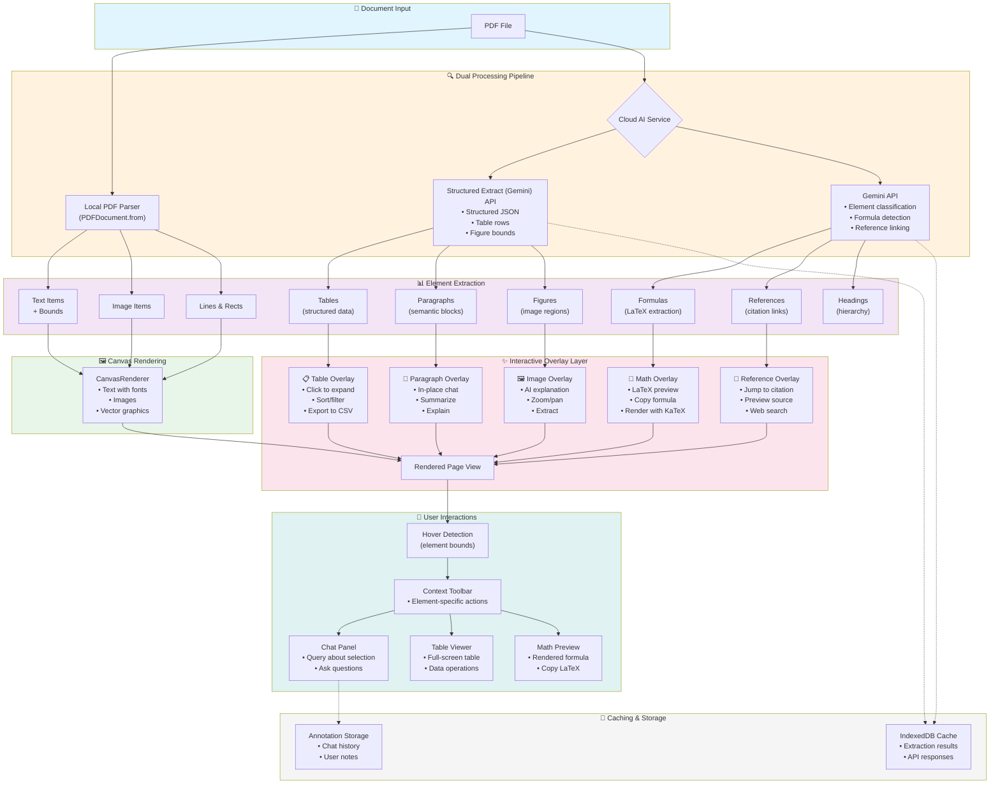
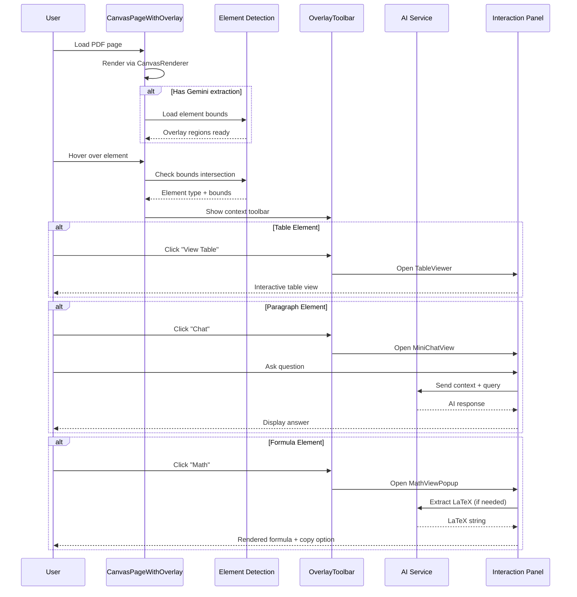

# PDF Layout Parser - Architecture Documentation

## Overview

PDF Layout Parser is a TypeScript library for extracting text, images, and layout metadata from PDF files without third-party parsing dependencies. It includes a React-based debugging application for visualization, AI-powered relevance detection, and semantic search.

---

## Project Structure

```
simple-pdf-parser/
├── src/                      # Main library (~9,100 lines)
│   ├── index.ts              # Library exports
│   ├── pdfDocument.ts        # Main API entry point
│   ├── types.ts              # Core type definitions
│   ├── parser/               # PDF parsing engine
│   │   ├── pdfParser.ts      # Core parser (3,715 lines)
│   │   ├── textTokenizer.ts  # Content stream tokenization
│   │   ├── textSmoother.ts   # Text run merging
│   │   ├── streamDecoder.ts  # FlateDecode decompression
│   │   ├── ccittDecoder.ts   # CCITT Group 4 fax decoder
│   │   └── mathUtils.ts      # Matrix transformations
│   ├── html/                 # HTML conversion
│   │   ├── htmlLayoutConverter.ts
│   │   └── htmlRenderer.ts
│   ├── query/                # AI relevance services
│   │   ├── relevanceTypes.ts
│   │   ├── relevanceAugmenter.ts
│   │   ├── openaiRelevanceService.ts
│   │   ├── mockRelevanceService.ts
│   │   ├── geminiApi.ts
│   │   ├── openAiApi.ts
│   │   ├── structuredExtractApi.ts
│   │   ├── openAiStructuredExtract.ts
│   │   ├── lmStudioApi.ts
│   │   └── xlsxTableParser.ts
│   ├── visual/               # Relevance rendering
│   │   ├── relevanceRenderer.ts
│   │   └── relevanceTheme.ts
│   ├── viewer/               # Canvas rendering
│   │   └── canvasRenderer.ts
│   └── utils/                # Encoding utilities
│       └── buffer.ts
├── testApp/                  # React debug application
│   └── src/
│       ├── App.tsx           # Main controller (1,166 lines)
│       ├── components/       # UI components
│       ├── search/           # Semantic search
│       ├── viewer/           # Structured data rendering
│       └── utils/            # App utilities
├── tests/                    # Vitest test suite
├── pdfs/                     # Test PDF files
└── docs/                     # Documentation
```

---

## Core Library Architecture

### Layer Diagram

```
┌─────────────────────────────────────────────────────────────────┐
│                         API Layer                                │
│  PDFDocument.from() │ convertLayoutToHtml() │ CanvasRenderer    │
└─────────────────────────────────────────────────────────────────┘
                                │
┌─────────────────────────────────────────────────────────────────┐
│                      Processing Layer                            │
│  PDFParser │ TextSmoother │ HtmlLayoutConverter │ Relevance     │
└─────────────────────────────────────────────────────────────────┘
                                │
┌─────────────────────────────────────────────────────────────────┐
│                       Utility Layer                              │
│  TextTokenizer │ StreamDecoder │ CCITTDecoder │ MathUtils       │
└─────────────────────────────────────────────────────────────────┘
                                │
┌─────────────────────────────────────────────────────────────────┐
│                      External Services                           │
│  OpenAI │ Gemini │ Structured Extract (Gemini/OpenAI) │ LM Studio       │
└─────────────────────────────────────────────────────────────────┘
```

---

## Module Reference

### Parser Module (`src/parser/`)

| File | Lines | Responsibility |
|------|-------|----------------|
| `pdfParser.ts` | 3,715 | Core PDF parsing engine |
| `textTokenizer.ts` | ~200 | Content stream tokenization |
| `textSmoother.ts` | 243 | Text run merging |
| `streamDecoder.ts` | ~50 | FlateDecode decompression |
| `ccittDecoder.ts` | ~150 | CCITT Group 4 fax decoder |
| `mathUtils.ts` | ~80 | Matrix transformations |

### HTML Module (`src/html/`)

| File | Lines | Responsibility |
|------|-------|----------------|
| `htmlLayoutConverter.ts` | ~500 | PDF to semantic HTML blocks |
| `htmlRenderer.ts` | ~300 | HTML DOM rendering |

### Query/Relevance Module (`src/query/`)

| File | Lines | Responsibility |
|------|-------|----------------|
| `relevanceTypes.ts` | 99 | Type definitions |
| `relevanceAugmenter.ts` | 94 | Annotation application |
| `openaiRelevanceService.ts` | ~200 | OpenAI integration |
| `mockRelevanceService.ts` | ~150 | Testing mock |
| `geminiApi.ts` | ~170 | Google Gemini API |
| `openAiApi.ts` | ~250 | OpenAI Responses API wrapper |
| `structuredExtractApi.ts` | ~200 | Structured Extract provider router |
| `openAiStructuredExtract.ts` | ~70 | OpenAI structured extract adapter |
| `lmStudioApi.ts` | ~100 | Local LLM integration |

### Visual Module (`src/visual/`)

| File | Lines | Responsibility |
|------|-------|----------------|
| `relevanceRenderer.ts` | ~300 | Styled DOM with highlights |
| `relevanceTheme.ts` | ~150 | Theme configuration |

### Viewer Module (`src/viewer/`)

| File | Lines | Responsibility |
|------|-------|----------------|
| `canvasRenderer.ts` | 519 | Canvas 2D rendering |

---

## High-Level Flow

1. **Input Normalization** – `PDFParser` accepts `string | Uint8Array | ArrayBuffer`. Binary sources pass through `bufferToLatin1`, which preserves raw bytes in Latin-1 form.

2. **Header Validation** – Verify `%PDF-` to guard against non-PDF input.

3. **Object Extraction** – `parseXRefTable` reads cross-reference table and caches every in-use object by byte offset.

4. **Page Assembly** – `buildPages` resolves `/Contents`, decodes streams, and walks ancestor `/Resources` dictionaries.

5. **Text & XObject Parsing** – Streams scanned for `BT … ET` blocks, tokenized, `Do` operators recurse into form XObjects.

6. **Tokenization** – Produces numeric, string, name, array, and command tokens.

7. **Operator Execution** – `parseTextBlock` handles text operators (`Tf`, `Td`, `TD`, `Tm`, `T*`, `Tj`, `'`, `TJ`).

8. **Layout Assembly** – Text runs grouped under `PDFPage` with image metadata and page size.

---

## Data Flow Diagrams

### PDF Processing Pipeline

```
PDF Binary (Uint8Array)
         │
         ▼
┌─────────────────┐
│   PDFParser     │  Parse xref, resolve objects, decompress streams
└────────┬────────┘
         │
         ▼
┌─────────────────┐
│  TextSmoother   │  Merge adjacent text runs
└────────┬────────┘
         │
         ▼
┌─────────────────┐
│   PDFLayout     │  Raw text items + images + page sizes
└────────┬────────┘
         │
    ┌────┴────┬─────────────┬──────────────┐
    ▼         ▼             ▼              ▼
 Canvas    HTML          Focus
 Render   Convert       Query
```

### Relevance/Focus Flow

```
HtmlDocumentLayout + Query
         │
         ▼
┌─────────────────────┐
│  RelevanceService   │  OpenAI/Gemini analyzes content
└─────────┬───────────┘
          │
          ▼
┌─────────────────────┐
│ RelevanceAugmenter  │  Maps annotations to blocks
└─────────┬───────────┘
          │
          ▼
┌─────────────────────┐
│ RelevanceRenderer   │  Creates styled DOM with highlights
└─────────────────────┘
```

---

## Test App Architecture

### Component Hierarchy

```
App.tsx (1,166 lines - Main Controller)
├── SemanticSearchBar
├── EmptyView (when no document)
├── ViewerColumn
│   ├── TabBar
│   ├── CanvasPageWithOverlay (per page)
│   │   └── TableViewer
│   ├── JSON views
│   ├── HTML render view
│   ├── Focus views
│   └── Playground components
└── ControlsSidebar (collapsible)
```

### TestApp Components

| Component | Lines | Responsibility |
|-----------|-------|----------------|
| `App.tsx` | 1,166 | Main state orchestration |
| `CanvasPageWithOverlay.tsx` | ~1,000 | Interactive canvas with overlays |
| `ViewerColumn.tsx` | ~400 | Content area rendering |
| `SemanticSearchBar.tsx` | ~250 | Search UI |
| `ControlsSidebar.tsx` | ~200 | Settings panel |
| `TableViewer.tsx` | ~450 | Table visualization |
| `EmptyView.tsx` | ~60 | Welcome screen |
| `GeminiPlayground.tsx` | ~300 | Gemini API testing |

### TestApp Utilities

| File | Responsibility |
|------|----------------|
| `fileCache.ts` | IndexedDB caching |
| `structured.ts` | Chapter/section detection |
| `pdfDecoration.ts` | Focus mode decorations |
| `recording.ts` | Focus session recording |
| `semanticSearch.ts` | Embedding-based search |

---

## API Reference

### Main Entry Point

```typescript
import { PDFDocument } from 'pdf-layout-parser';

const doc = await PDFDocument.from(pdfBytes);
const text = doc.getText();
const page = doc.getPage(1);
const textItems = doc.getTextItems();
const images = doc.getImageItems();
```

### HTML Conversion

```typescript
import { convertLayoutToHtml, renderHtmlLayout } from 'pdf-layout-parser';

const htmlLayout = convertLayoutToHtml(doc.layout);
renderHtmlLayout(container, htmlLayout);
```

### Canvas Rendering

```typescript
import { CanvasRenderer } from 'pdf-layout-parser';

const renderer = new CanvasRenderer({ scale: 1.5 });
renderer.render(canvas, doc, pageNumber);
renderer.zoomIn();
```

### Relevance Service

```typescript
import { OpenAiRelevanceService, DefaultRelevanceAugmenter } from 'pdf-layout-parser';

const service = new OpenAiRelevanceService(config);
const response = await service.analyze({ layout: htmlLayout, query: "find revenue" });
const augmented = new DefaultRelevanceAugmenter().augment(htmlLayout, response);
```

---

## Dependencies

### Runtime
| Package | Purpose |
|---------|---------|
| `pako` | zlib decompression |
| `@google/genai` | Gemini API |
| `jszip` | ZIP extraction |
| `xlsx` | Excel parsing |

### Development
| Package | Purpose |
|---------|---------|
| `typescript` | Type checking |
| `vitest` | Testing |
| `vite` | Build/dev server |
| `react` | UI framework |

---

## Interactive Document Intelligence Flow

The system provides an intelligent document viewing experience by combining PDF rendering with AI-powered element extraction and interactive overlays.

### End-to-End Flow Diagram (Mermaid)



### Component Interactions



### Overlay Feature Matrix

| Element Type | Detection Source | Overlay Features | Interactive Actions |
|-------------|------------------|------------------|---------------------|
| **Paragraph** | Structured Extract (Gemini) / Gemini | Highlight bounds | Chat, Summarize, Explain |
| **Table** | Structured Extract (Gemini) | Cell grid overlay | Sort, Filter, Export, Full-screen |
| **Formula** | Gemini Vision | Math region highlight | LaTeX preview, Copy, KaTeX render |
| **Figure** | Structured Extract (Gemini) | Image bounds | AI explain, Zoom, Extract |
| **Reference** | Gemini parsing | Citation highlight | Jump to source, Preview, Web search |
| **Heading** | Gemini / Local | Section marker | Navigate, Collapse section |

### Data Flow Summary

1. **PDF Loading** → Local parser extracts text/images for canvas rendering
2. **Cloud Extraction** → Gemini API identifies semantic elements with bounds
3. **Bounds Alignment** → `elementBoundsAligner.ts` maps cloud coordinates to local page coordinates
4. **Overlay Registration** → Element bounds stored in `GeminiDocumentExtraction`
5. **Hover Detection** → Mouse position checked against registered bounds
6. **Context Actions** → Element-specific toolbar appears with relevant actions
7. **Interaction Panels** → TableViewer, MiniChatView, MathViewPopup provide rich interactions
8. **Caching** → Results cached in IndexedDB for offline access and performance

---

## Extensibility Notes

- **Stream Filters** – `/FlateDecode` supported; add decoders for LZW, ASCII85, DCT, JPX.
- **Graphics State** – Extend `TextState` with matrices, color, word-spacing.
- **Cross-Reference** – Support incremental updates, object streams, compressed xrefs.
- **Font Encodings** – Expand to full Adobe Glyph List for non-Latin scripts.
